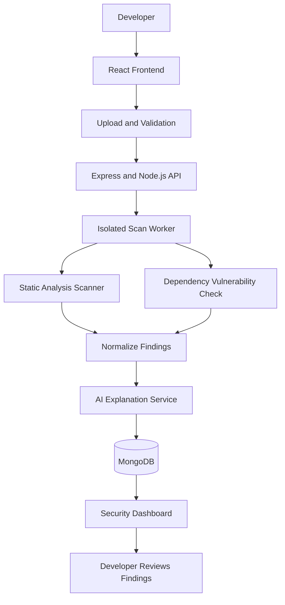

 SecureLens-AI
SecureLens AI detects code security problems and suggests fixes using AI.
SecureLens AI — Intelligent Code Security Analyzer
SecureLens AI — Intelligent Code Security Analyzer
1. Project Title and Description

SecureLens AI is a web-based security analysis platform designed to help developers identify potential vulnerabilities in their source code. It analyzes uploaded code files, detects insecure coding patterns and exposed secrets, checks dependencies for known vulnerabilities, and provides understandable explanations and remediation suggestions.

The goal is to make basic code security analysis accessible to students, beginner developers, and small development teams.

2. Problem Statement

Developers may unknowingly introduce security vulnerabilities while writing software. Beginners often find security reports difficult to understand and may not know how to fix the detected issues. Manually reviewing code and checking dependencies can also be time-consuming.

SecureLens AI aims to simplify this process by providing a centralized platform for code scanning, severity-based reports, and AI-assisted remediation guidance.

 3. Target Users

- Computer science students learning secure coding.
- Beginner and professional software developers.
- College project teams.
- Small software development teams.
- Open-source contributors who have permission to scan a repository.

 4. Existing Solutions

 A. Semgrep
Website: https://semgrep.dev/

Semgrep is a static analysis tool that identifies insecure coding patterns and other code issues. SecureLens AI aims to provide a beginner-friendly dashboard with simplified explanations and a unified view of scan results.

 B. Snyk Code
Website: https://snyk.io/product/snyk-code/

Snyk Code provides static application security testing and developer-focused remediation guidance. SecureLens AI aims to develop a learning-oriented interface that combines scan results, explanations, and remediation suggestions in one place.

These tools already provide substantial security capabilities. SecureLens AI is an educational project and will not initially match their full detection coverage or accuracy.

 5. Proposed Solution and Innovation

SecureLens AI will provide a web interface where users can upload supported source code files or submit an authorized project for analysis.

The platform will:
- Scan code for potentially insecure patterns.
- Identify hardcoded secrets and credentials using suitable detection rules.
- Check supported dependencies against known vulnerability databases.
- Categorize findings by severity.
- Explain detected issues in simple language using an AI service.
- Suggest safer coding practices and possible fixes.
- Display scan history and findings through a dashboard.

Proposed innovation: A student-friendly security analysis workflow that combines automated scanning, understandable explanations, and actionable remediation guidance in one interface.

AI-generated advice will be treated as a suggestion and reviewed by the developer rather than automatically trusted or applied.

 6. Minimum Viable Product (MVP) Features

1. User Interface: A responsive homepage and security dashboard.
2.  Code Upload: Upload supported source code files with file type and size validation.
3. Static Code Analysis: Integrate a security scanner to detect selected vulnerable patterns.
4. Security Reports: Display findings with severity, file name, line number, and issue description.
5. Remediation Guidance: Provide explanations and suggested fixes for detected issues.
6. Scan History: Store scan metadata and results for later review.
7. Secure Processing: Scan authorized files in an isolated environment without executing uploaded code.

Dependency scanning and advanced AI explanations can be introduced incrementally if they are beyond the initial implementation scope.

 7. Technology Stack

The initial implementation will use the MERN stack.

| Technology | Purpose |
|---|---|
| MongoDB | Store users, scan metadata, and security findings |
| Express.js | Build backend API endpoints |
| React.js | Develop the frontend and interactive dashboard |
| Node.js | Run the backend server |
| Semgrep | Static analysis of supported source code |
| Git and GitHub | Version control and team collaboration |
| Docker | Isolate scanning workloads and package services |
| GitHub Actions | Run automated tests and quality checks |
| AI API | Explain findings and suggest remediation |
| OSV API | Check supported dependencies for known vulnerabilities |

The team will first implement the MERN-based application. Additional services or a separate Python/FastAPI scanning service may be introduced later if required.

 8. Draft Architectural Flow Diagram

 Architecture Explanation

1. The developer uploads supported code through the React interface.
2. The backend validates the request and securely manages the scan.
3. An isolated scanning worker analyzes the submitted code without executing it.
4. The scanner checks code patterns, and the dependency checker identifies known vulnerabilities in supported packages.
5. Findings are normalized and optionally sent to an AI service for explanations and remediation suggestions.
6. Scan metadata and results are stored in MongoDB.
7. The dashboard displays findings, severity levels, affected files, and recommendations.

 9. Initial Development Plan

- Phase 1: Create the repository, README, and architecture diagram.
- Phase 2: Build the React interface and upload form.
- Phase 3: Implement the Express backend and file validation.
- Phase 4: Integrate the static analysis scanner.
- Phase 5: Display scan results on the dashboard.
- Phase 6: Add AI explanations, dependency checks, and scan history.
- Phase 7: Add automated testing, isolated processing, and deployment.

 10. Security and Responsible Use

- Scan only repositories and files that the user owns or is authorized to assess.
- Never execute uploaded code directly on the application server.
- Process untrusted files in isolated environments with resource limits.
- Validate uploads and restrict accepted file types and sizes.
- Protect API keys and credentials using environment variables.
- Avoid storing uploaded source code unnecessarily.
- Treat scanner results as potential findings that require review.
- Treat AI-generated remediation advice as unverified until reviewed and tested.

 11. Expected Outcome

The expected outcome is a working web application that accepts supported source code, runs security analysis, and presents structured findings through a user-friendly dashboard. The project will demonstrate full-stack development, API integration, secure file processing, cybersecurity fundamentals, and collaborative software development.
